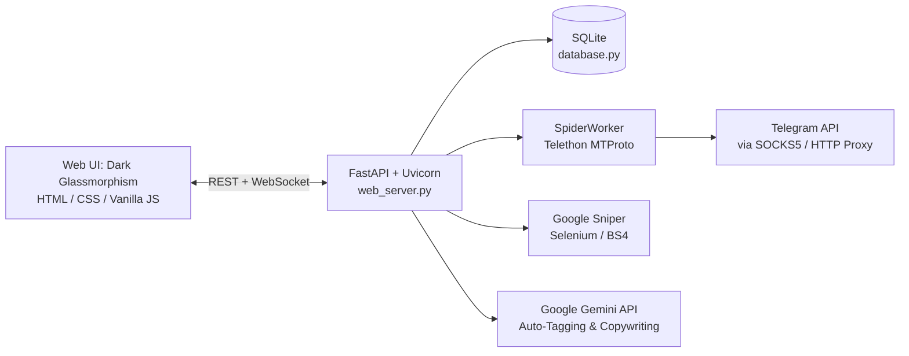
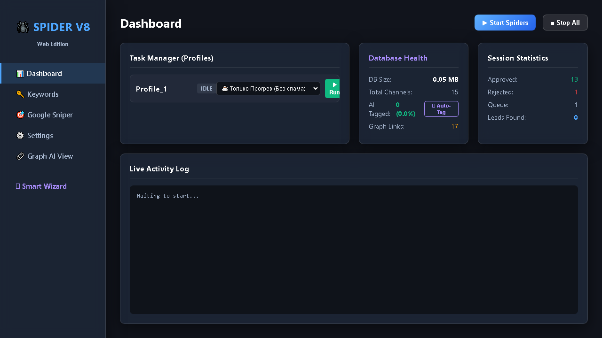
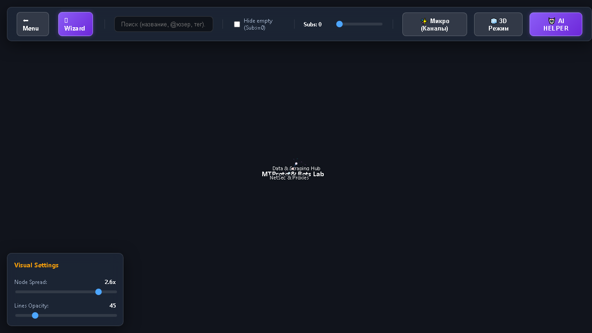
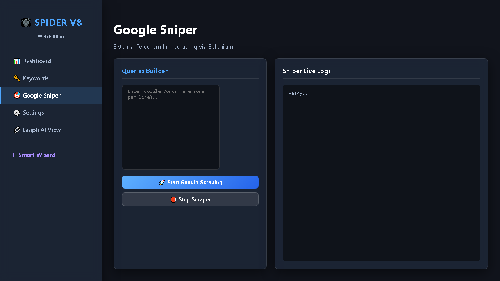
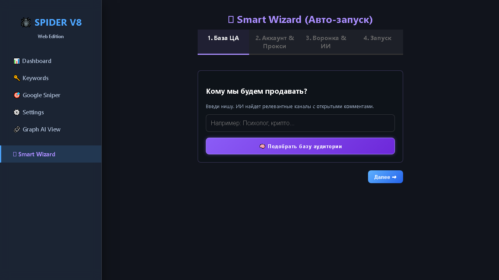
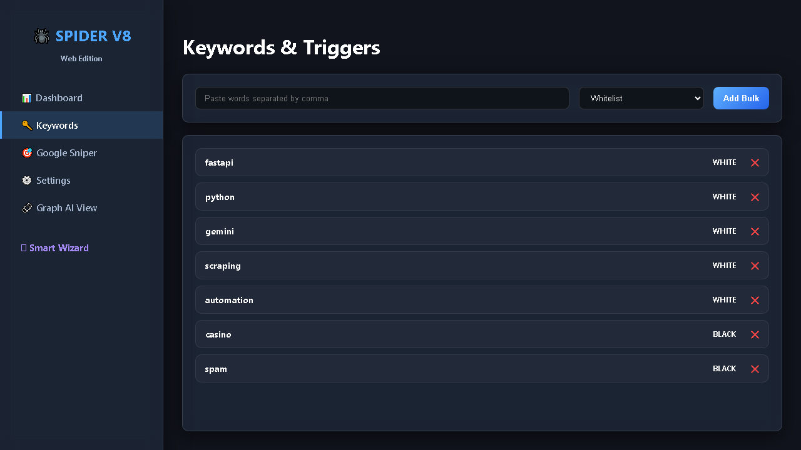
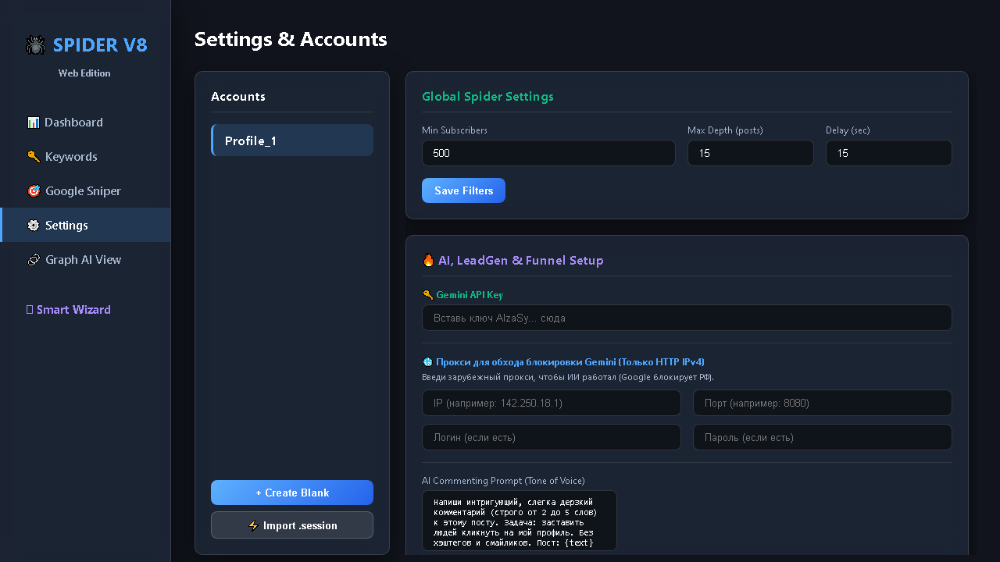

# 🕷️ SPIDER V8 — Telegram Graph Intelligence & AI Automation

Веб-платформа на **FastAPI + Telethon + Google Gemini** для сбора, анализа и визуализации графа связей Telegram-каналов, с умным мастером настройки профилей, Google Sniper и real-time мониторингом через WebSocket.


---

## 🎬 Видеодемонстрация

📹 **[Смотреть демо-видео (`assets/demo.mp4`)](./assets/demo.mp4)**

*(Совет для GitHub: при редактировании `README.md` на сайте перетащите `assets/demo.mp4` в текст **отдельным абзацем с пустыми строками сверху и снизу** — GitHub заменит ссылку на встроенный видеоплеер.)*

---

## ✨ Основные возможности

- **📊 Dashboard & Live Logs (`dashboard.html`)** — управление несколькими профилями, статистика БД (`Approved`, `Rejected`, `Queue`, `Leads`), размер базы и потоковый вывод логов через **WebSocket (`/ws`)**.
- **🔗 Graph AI View (`index.html`)** — интерактивный граф связей между каналами (упоминания, репосты), макро/микро-режимы и авто-тегирование контента через **Google Gemini API**.
- **🎯 Google Sniper (`sniper.html`)** — поиск Telegram-каналов по Google Dorks (`selenium` / `undetected-chromedriver`), проверка через `t.me/s/`, подсчёт подписчиков и проверка открытых комментариев.
- **🪄 Smart Wizard (`wizard.html`)** — пошаговая настройка аккаунта: импорт `tdata`/сессий, тест прокси (SOCKS5/HTTP), проверка статуса в `@SpamBot`, AI-генерация имени/био и превью комментариев через Gemini.
- **🔑 Keywords (`keywords.html`)** — управление белыми и чёрными списками ключевых слов для фильтрации каналов.
- **⚙️ Settings (`settings.html`)** — глобальные лимиты парсинга, настройка Gemini API Key и прокси, управление профилями и аватарами (`Pillow`).

---

## 🏗 Архитектура



---

## 📸 Интерфейс

### Dashboard & Live Activity Log


### Graph AI View


### Google Sniper


### Smart Wizard


### Keywords & Settings
| Keywords | Settings |
|---|---|
|  |  |

---

## 🚀 Установка и запуск

### 1. Клонирование и зависимости

```bash
git clone https://github.com/vztyz/spider-v8.git
cd spider-v8
python -m venv venv

# Windows:
venv\Scripts\activate
# Linux / macOS:
source venv/bin/activate

pip install -r requirements.txt
```

### 2. Запуск

```bash
python main.py
```

Сервер поднимется на `http://127.0.0.1:8050/dashboard.html` и автоматически откроет интерфейс в браузере.

### 3. Первичная настройка

1. Откройте вкладку **Settings** и укажите ваш **Gemini API Key** (и прокси, если требуется).
2. Создайте профиль или импортируйте сессию через **Smart Wizard** (`api_id`, `api_hash`, прокси).
3. Настройте фильтры во вкладке **Keywords** и запускайте сбор с **Dashboard** или через **Google Sniper**.

---

## 📁 Структура проекта

```text
├── main.py              # Точка входа (Uvicorn + автооткрытие браузера)
├── web_server.py        # FastAPI-приложение, REST API, WebSocket и интеграция с Gemini
├── spider_core.py       # Асинхронный MTProto-воркер на базе Telethon
├── database.py          # Потокобезопасный менеджер SQLite и схема таблиц
├── gogle.py             # Google Sniper (Selenium / undetected-chromedriver + BS4)
├── requirements.txt     # Зависимости проекта
├── .gitignore           # Исключение .env, .session, .db, .csv и кэша
├── assets/              # Скриншоты и демо-видео
└── web/                 # Фронтенд (HTML / CSS / JS)
```

---

## 🔒 Безопасность

- Файлы сессий (`*.session`), `tdata/`, базы данных (`*.db`), выгрузки (`*.csv`) и `.env` исключены из репозитория через `.gitignore`.
- Используйте собственные API-ключи (`api_id`, `api_hash`, `GEMINI_API_KEY`) и соблюдайте правила использования соответствующих платформ.
